<picture>
  <source media="(prefers-color-scheme: dark)" srcset="assets/banner-night.gif">
  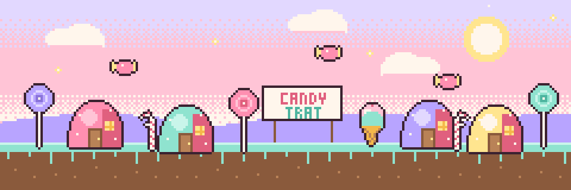
</picture>

<p align="center">
  
</p>

<p align="center">
  
</p>

Hi! I'm **Pipothai** from Trat, a small seaside province in the east of Thailand 🏝️
I make cozy games, Minecraft mods, and the backend systems that keep real shops and real towns running.
I started two years ago with a PHP site about public health, and somewhere along the way I fell into games and never climbed back out.

> สวัสดี! ยินดีที่ได้รู้จักนะ ชอบเกมอินดี้ ชอบพิกเซลอาร์ต และชอบของหวาน 🍰


## 🍬 Candy Jar

<p align="center">
  <a href="#-candy-jar"></a>
</p>

<details>
<summary><b>Open the jar</b> (everything I've packed so far)</summary>
<br>

| | Flavour | What's inside |
|---|---|---|
| 🍬 | **Hard candy** (languages) | Java · Go · TypeScript · Luau · GDScript · SQL · PHP · Python |
| 🧁 | **Cupcakes** (frameworks) | Forge / NeoForge / Fabric · GeckoLib · Roblox Studio + Rojo · Godot 4 · Nuxt / Vue · Next.js · React + Vite · Astro · Echo · NestJS |
| 🍦 | **Ice cream** (data) | PostgreSQL · PostGIS · TimescaleDB · Valkey · MinIO · Cloudflare D1 |
| ✨ | **Sprinkles** (ship it) | Docker · GitHub Actions · Cloudflare Workers · Caddy · Prometheus · k6 · Playwright · Vitest |
| 🎨 | **Frosting** (art) | Blender · Blockbench · pixel art |

</details>


## 📜 Quest Log

**★ Main quests** (games and mods I'm making now)

<p align="center">
  <a href="https://www.roblox.com/games/71566751767858/LastLight"></a>
  
  <a href="https://tarcoparoni.ropmuang.workers.dev/choocreamskinhd"></a>
  <a href="https://modrinth.com/mod/static-resonance"></a>
  
</p>

**◆ Side quests** (systems I've built for real people; the code is private, the stories aren't)

<p align="center">
  
  
  
  
</p>

**✓ Cleared** (where it all started)

<p align="center">
  
  <a href="https://github.com/aletheiamask/Public-Health"></a>
  <a href="https://home-trat.pages.dev/"></a>
</p>


## 🏆 Achievements

```text
2024.09  🏆 Hello, World           first repo: a public health site in PHP
2025.07  🏆 Game Maker             first game: Molly's Adventure Maze (Godot)
2025.07  🏆 Hometown Hero          Welcome to Trat goes live
2025.12  🏆 Real Customers         first system running in a real shop
2026.08  🏆 Block by Block         first Minecraft mod + first Cloudflare Worker
2026.08  🏆 Published!             Static Resonance released on Modrinth
2026.10  🏆 Gopher                 first Go server in production
2026.10  🏆 World Builder          first Roblox world: Last Light
   ????  🔒 ???                    (still playing)
```


## 🗺️ World Map

<picture>
  <source media="(prefers-color-scheme: dark)" srcset="profile-3d-contrib/candy-night.svg">
  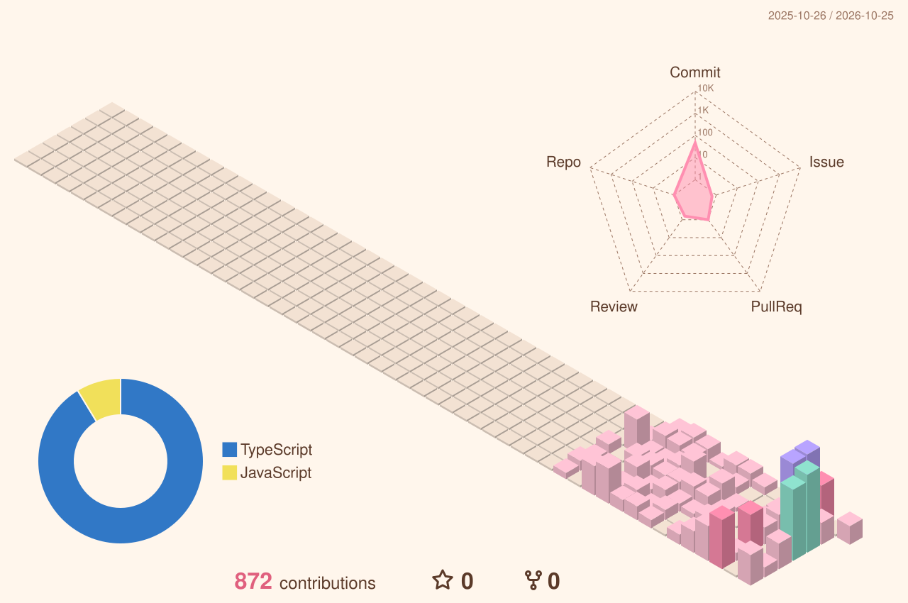
</picture>

<picture>
  <source media="(prefers-color-scheme: dark)" srcset="https://raw.githubusercontent.com/aletheiamask/aletheiamask/output/candy-snake-dark.svg">
  
</picture>


## 🍭 Candy Garden

<p align="center">A tiny game you can play right here. <b>Click any plot</b>, press <b>Submit</b>, and a bot will plant, water or harvest it for you.<br>
<sub>คลิกแปลงไหนก็ได้ แล้วกด Submit บอทจะปลูก รดน้ำ หรือเก็บเกี่ยวให้ · plant → water → water → harvest</sub></p>

<!-- GARDEN:START -->
<table align="center"><tr><td align="center"><a href="https://github.com/aletheiamask/aletheiamask/issues/new?title=garden%7Ctend%7C1&body=Just%20press%20**Submit%20new%20issue**.%20A%20bot%20will%20tend%20the%20plot%20for%20you%20%F0%9F%8D%AC"></a></td><td align="center"><a href="https://github.com/aletheiamask/aletheiamask/issues/new?title=garden%7Ctend%7C2&body=Just%20press%20**Submit%20new%20issue**.%20A%20bot%20will%20tend%20the%20plot%20for%20you%20%F0%9F%8D%AC"></a></td><td align="center"><a href="https://github.com/aletheiamask/aletheiamask/issues/new?title=garden%7Ctend%7C3&body=Just%20press%20**Submit%20new%20issue**.%20A%20bot%20will%20tend%20the%20plot%20for%20you%20%F0%9F%8D%AC"></a></td><td align="center"><a href="https://github.com/aletheiamask/aletheiamask/issues/new?title=garden%7Ctend%7C4&body=Just%20press%20**Submit%20new%20issue**.%20A%20bot%20will%20tend%20the%20plot%20for%20you%20%F0%9F%8D%AC"></a></td><td align="center"><a href="https://github.com/aletheiamask/aletheiamask/issues/new?title=garden%7Ctend%7C5&body=Just%20press%20**Submit%20new%20issue**.%20A%20bot%20will%20tend%20the%20plot%20for%20you%20%F0%9F%8D%AC"></a></td></tr><tr><td align="center"><a href="https://github.com/aletheiamask/aletheiamask/issues/new?title=garden%7Ctend%7C6&body=Just%20press%20**Submit%20new%20issue**.%20A%20bot%20will%20tend%20the%20plot%20for%20you%20%F0%9F%8D%AC"></a></td><td align="center"><a href="https://github.com/aletheiamask/aletheiamask/issues/new?title=garden%7Ctend%7C7&body=Just%20press%20**Submit%20new%20issue**.%20A%20bot%20will%20tend%20the%20plot%20for%20you%20%F0%9F%8D%AC"></a></td><td align="center"><a href="https://github.com/aletheiamask/aletheiamask/issues/new?title=garden%7Ctend%7C8&body=Just%20press%20**Submit%20new%20issue**.%20A%20bot%20will%20tend%20the%20plot%20for%20you%20%F0%9F%8D%AC">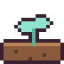</a></td><td align="center"><a href="https://github.com/aletheiamask/aletheiamask/issues/new?title=garden%7Ctend%7C9&body=Just%20press%20**Submit%20new%20issue**.%20A%20bot%20will%20tend%20the%20plot%20for%20you%20%F0%9F%8D%AC"></a></td><td align="center"><a href="https://github.com/aletheiamask/aletheiamask/issues/new?title=garden%7Ctend%7C10&body=Just%20press%20**Submit%20new%20issue**.%20A%20bot%20will%20tend%20the%20plot%20for%20you%20%F0%9F%8D%AC"></a></td></tr><tr><td align="center"><a href="https://github.com/aletheiamask/aletheiamask/issues/new?title=garden%7Ctend%7C11&body=Just%20press%20**Submit%20new%20issue**.%20A%20bot%20will%20tend%20the%20plot%20for%20you%20%F0%9F%8D%AC"></a></td><td align="center"><a href="https://github.com/aletheiamask/aletheiamask/issues/new?title=garden%7Ctend%7C12&body=Just%20press%20**Submit%20new%20issue**.%20A%20bot%20will%20tend%20the%20plot%20for%20you%20%F0%9F%8D%AC"></a></td><td align="center"><a href="https://github.com/aletheiamask/aletheiamask/issues/new?title=garden%7Ctend%7C13&body=Just%20press%20**Submit%20new%20issue**.%20A%20bot%20will%20tend%20the%20plot%20for%20you%20%F0%9F%8D%AC"></a></td><td align="center"><a href="https://github.com/aletheiamask/aletheiamask/issues/new?title=garden%7Ctend%7C14&body=Just%20press%20**Submit%20new%20issue**.%20A%20bot%20will%20tend%20the%20plot%20for%20you%20%F0%9F%8D%AC"></a></td><td align="center"><a href="https://github.com/aletheiamask/aletheiamask/issues/new?title=garden%7Ctend%7C15&body=Just%20press%20**Submit%20new%20issue**.%20A%20bot%20will%20tend%20the%20plot%20for%20you%20%F0%9F%8D%AC"></a></td></tr></table>

<p align="center"><b>0</b> sweets harvested together so far · ช่วยกันปลูกขนมไปแล้ว <b>0</b> ชิ้น</p>

<p align="center">🧁 Top bakers: <a href="https://github.com/aletheiamask">@aletheiamask</a> (1)</p>

<p align="center"><sub>Latest: aletheiamask planted plot 8</sub></p>
<!-- GARDEN:END -->


<p align="center">
  <a href="https://modrinth.com/user/aletheiamask">Modrinth</a> ·
  <a href="https://www.roblox.com/games/71566751767858/LastLight">Last Light on Roblox</a> ·
  <a href="https://tarcoparoni.ropmuang.workers.dev/">Tacoparoni studio</a> ·
  <a href="https://home-trat.pages.dev/">Welcome to Trat</a> ·
  <a href="mailto:aletheiamask@gmail.com">aletheiamask@gmail.com</a>
</p>

<p align="center"><b>Thanks for playing ✦</b><br><sub>ขอบคุณที่แวะมา ขอให้วันนี้หวาน ๆ 🍬</sub></p>
